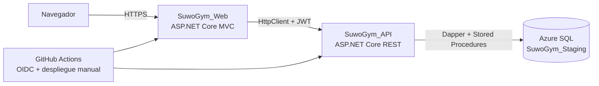

# SUWÓ GYM | Gym Management System


[](https://github.com/HenryGonzalezAlguera/SuwoGym/actions/workflows/dotnet-ci.yml)

**SUWÓ GYM** es una plataforma web de gestión de gimnasios desarrollada con **C# / .NET 10, ASP.NET Core MVC, API REST, Dapper y SQL Server**. Incluye módulos de administración, entrenamiento y membresías, con autenticación y autorización por roles.


> **English summary:** Full-stack gym management portfolio project featuring .NET 10, ASP.NET Core MVC, REST API, Dapper, Azure SQL, JWT authentication and role-based modules. A **public Azure staging demo** is available. Registration, login, health checks and database connectivity have been verified. Administration, training, reservations and payment workflows still require end-to-end staging validation. Not a production service.

## Demostración en Azure

**[Abrir aplicación WEB — SUWÓ GYM](https://suwogym-stg-web-hga-emfxdjcfccabdfh2.centralus-01.azurewebsites.net/)**

| Servicio | URL |
| --- | --- |
| Aplicación WEB | [Ingresar a SUWÓ GYM](https://suwogym-stg-web-hga-emfxdjcfccabdfh2.centralus-01.azurewebsites.net/) |
| Salud de la API | [API /health/ready](https://suwogym-stg-api-hga-hsdmctgddbbxgpf4.centralus-01.azurewebsites.net/health/ready) |
| Salud de la WEB | [WEB /health/ready](https://suwogym-stg-web-hga-emfxdjcfccabdfh2.centralus-01.azurewebsites.net/health/ready) |

El entorno de demostración utiliza dos **Azure App Services independientes** (API y WEB), **Azure SQL Database `SuwoGym_Staging`** y el plan compartido gratuito **Linux F1 `asp-stockflow-free`**. Las aplicaciones de SUWÓ GYM están separadas de StockFlow; comparten únicamente recursos de hosting del plan.

El nivel gratuito tiene límites de recursos y la base SQL puede pausarse por inactividad o cuota. **No se ofrece disponibilidad continua ni se considera una instalación de producción.** Para probar el registro, utiliza datos ficticios y un correo de prueba bajo tu control; no introduzcas datos sensibles ni realices pagos reales.

## Funcionalidades

| Área | Capacidades existentes en el código |
| --- | --- |
| **Miembro** | Registro, inicio de sesión, perfil, pagos, clases, reservas, historial de asistencia y rutinas |
| **Administrador** | Dashboard, empleados, clientes, planes, membresías, catálogo de clases, horarios y pagos |
| **Entrenador** | Clientes asignados, ejercicios, rutinas, horarios y asistencia |
| **Seguridad** | JWT, BCrypt, sesiones web, control de acceso por rol, protección antifalsificación, límites de peticiones, recuperación de contraseña con enlaces de un solo uso y revocación de tokens |
| **Integración** | API REST, Dapper, procedimientos almacenados, health checks, pruebas automatizadas y despliegue manual en Azure |

**Nota de alcance:** estas son funcionalidades implementadas o representadas en el código. No implica que todos los recorridos hayan sido probados extremo a extremo en Azure.

## Arquitectura



- **`SuwoGym_Web/`**: interfaz Razor/MVC, sesiones y autorización por roles.
- **`SuwoGym_API/`**: API REST, validación, JWT, reglas de negocio y consultas SQL.
- **`Database/`**: esquema, procedimientos y scripts específicos para desarrollo y staging.
- **`SuwoGym.Tests/`**: pruebas automatizadas xUnit y de contratos HTTP.
- **`tools/SuwoGym.SqlIntegration/`**: pruebas SQL reales opt-in, exclusivamente sobre base ficticia aislada.
- **`.github/workflows/`**: CI, preflight y publicación controlada.

### Stack técnico

**C# / .NET 10 · ASP.NET Core MVC · Web API · Razor · JavaScript · Bootstrap · Dapper · SQL Server · Azure SQL · JWT · BCrypt · MailKit · GitHub Actions · Azure App Service.**

## Estado y evidencia verificada — noviembre de 2026

| Prueba | Estado |
| --- | --- |
| Compilación y tests desde GitHub Actions | ✅ Aprobados |
| Preflight de OIDC, Linux F1 y plan autorizado | ✅ Aprobado |
| Despliegue manual de API y WEB | ✅ Workflow #4 completado correctamente |
| API `/health/live` y `/health/ready` | ✅ Respuesta saludable verificada |
| WEB `/health/live` y `/health/ready` | ✅ Respuesta saludable verificada |
| Registro, login y panel del Miembro | ✅ Probados manualmente contra Azure |
| Vistas de clases disponibles y mis reservas | ✅ Cargan; el staging no tenía horarios futuros |
| Altas de entrenador/admin, reservas, pagos, asistencia en Azure | ⏳ Pendientes de prueba de extremo a extremo |
| Capturas de pantalla publicadas en el repositorio | ⏳ Pendientes |

El despliegue es **manual**, utiliza OIDC y comprueba destinos autorizados, plan Linux F1 y endpoints de salud. No crea bases de datos ni ejecuta migraciones SQL automáticamente.

## Ejecución local

**Requisitos:** .NET SDK 10, Visual Studio compatible o CLI de .NET, SQL Server de desarrollo, secretos configurados fuera de Git.

```powershell
git clone https://github.com/HenryGonzalezAlguera/SuwoGym.git
cd SuwoGym
dotnet restore .\SuwoGym.slnx
dotnet build .\SuwoGym.slnx -c Release --no-restore
dotnet test .\SuwoGym.Tests\SuwoGym.Tests.csproj -c Release
```

Configura la API, SQL, JWT, SMTP y URL base de la WEB según [Seguridad y configuración](docs/SEGURIDAD_Y_CONFIGURACION.md) y [Database/README.md](Database/README.md). No existen credenciales públicas predeterminadas.

```powershell
# Terminal 1: API
dotnet run --project .\SuwoGym_API\SuwoGym_API.csproj --launch-profile https

# Terminal 2: WEB
dotnet run --project .\SuwoGym_Web\SuwoGym_Web.csproj --launch-profile https
```

**No ejecutes scripts destructivos, scripts con usuarios precargados ni migraciones locales sobre una base de datos existente o sobre Azure staging.** Revisa primero las instrucciones de cada ambiente. Los scripts en `Database/` no sustituyen una instalación automatizada segura.

## Documentación y calidad

- [CI .NET](.github/workflows/dotnet-ci.yml) · [Preflight Azure](.github/workflows/azure-staging-preflight.yml) · [Despliegue manual](.github/workflows/azure-staging-manual.yml)
- [Preparación de staging](docs/FASE8A_PREPRODUCCION.md) · [Azure staging](docs/FASE8B_AZURE_STAGING.md) · [Linux F1](docs/FASE8C_AZURE_LINUX_F1.md)
- [Seguridad JWT, CSRF y autenticación](docs/FASE6A_SEGURIDAD_AUTENTICACION.md) · [Recuperación segura](docs/FASE6B2_RECUPERACION_ENLACES.md) · [Revocación JWT](docs/FASE6C_REVOCACION_JWT.md)
- [Pruebas HTTP](docs/FASE7A_PRUEBAS_HTTP.md) · [Pruebas SQL reales aisladas](docs/FASE7B_SQL_REAL.md)
- [Creación de clases](docs/FASE3B_CATALOGO_CLASES.md) · [Administrador de desarrollo](docs/FASE3_ADMIN_Y_DATOS_DE_PRUEBA.md)

## Próximas mejoras

1. Publicar capturas reales del inicio y las pantallas funcionales (sin datos personales).
2. Preparar cuentas ficticias de Administrador y Entrenador en staging mediante un mecanismo controlado.
3. Probar reservas, pagos simulados, rutinas y asistencias de extremo a extremo en Azure.
4. Evaluar monitoreo, controles de seguridad y un plan de hosting adecuado antes de cualquier uso comercial.

## Autor

**Henry González Alguera** — proyecto académico y de portafolio Full Stack .NET.

[Perfil de GitHub](https://github.com/HenryGonzalezAlguera) · [Demo de SUWÓ GYM](https://suwogym-stg-web-hga-emfxdjcfccabdfh2.centralus-01.azurewebsites.net/)
