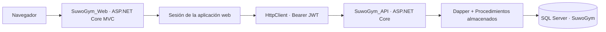

# SUWÓ GYM | Gym Management System


[](https://github.com/HenryGonzalezAlguera/SuwoGym/actions/workflows/dotnet-ci.yml)

**SUWÓ GYM** es un proyecto académico de gestión de gimnasios desarrollado con una aplicación **ASP.NET Core MVC**, una **API REST** y **SQL Server**. Incluye módulos diferenciados por tipo de usuario para administración, entrenamiento y membresías.

> **English summary:** A .NET 10 gym-management portfolio project featuring separate ASP.NET Core MVC and REST API applications, Dapper/SQL Server persistence, JWT authentication, and role-specific modules for administrators, trainers, and members. This repository is a **source-code portfolio project**, not a publicly deployed service.

## Componentes del sistema

| Área | Funcionalidad identificada en el código |
| --- | --- |
| Administrador | Panel de indicadores, empleados, clientes, planes, membresías, programación de clases y pagos |
| Entrenador | Clientes asignados, rutinas, ejercicios, horarios y registro de asistencia |
| Miembro | Perfil, rutinas, historial de asistencia, pagos, clases y reservas |
| Autenticación | Login, registro y recuperación de acceso; hash BCrypt y tokens JWT |
| Infraestructura | API + MVC, servicios HTTP, Dapper, procedimientos almacenados y SQL Server |

Las funcionalidades se identificaron en controladores y vistas. **No se afirma que todos los recorridos estén probados extremo a extremo**; la validación de bases de datos, roles y operaciones reales forma parte del trabajo siguiente.

## Arquitectura



- **`SuwoGym_Web/`**: interfaz Razor/MVC, vistas por rol y consumo HTTP de la API.
- **`SuwoGym_API/`**: controladores REST, autenticación JWT y acceso a SQL Server.
- **`Database/`**: esquema y datos iniciales en SQL. No contiene una base de datos real ni credenciales.
- **`IEEE/`**: recursos académicos de modelado.

La API declara autorización por roles numéricos: `1` Administrador, `2` Entrenador, `3` Miembro. La web conserva el patrón actual de sesión mediante `SessionAuthorize`. **La seguridad de esta web requiere una revisión posterior**, especialmente autorización por rol en el servidor, CSRF y revocación de sesión.

## Tecnologías

| Capa | Herramientas |
| --- | --- |
| Lenguaje / framework | C#, .NET 10, ASP.NET Core |
| Interfaz | MVC / Razor, HTML, CSS, JavaScript y Bootstrap |
| Datos | SQL Server, Dapper, procedimientos almacenados |
| Identidad | JWT Bearer, BCrypt y sesiones web |
| Correo | MailKit / SMTP, configurable fuera del repositorio |
| CI | GitHub Actions: restauración y compilación de ambos proyectos |

## Ejecución local

**Requisitos:** SDK de .NET 10, SQL Server y una instancia local de base de datos configurada. Para usar Visual Studio, abre `SuwoGym.slnx`.

1. Clonar el repositorio:

```powershell
git clone https://github.com/HenryGonzalezAlguera/SuwoGym.git
cd SuwoGym
```

2. Revisar [Database/README.md](Database/README.md). Los archivos públicos disponibles son `01_SuwoGym_Estructura.sql` y `02_SuwoGym_DatosIniciales.sql`. **La guía anterior menciona una plantilla `03` de administrador que no está en el repositorio**; no ejecutar un script inexistente ni crear credenciales reales directamente desde ejemplos públicos.

3. **Configurar secretos locales antes de iniciar la API**. No hay clave JWT ni contraseña SMTP predeterminadas. Sigue los pasos en [SEGURIDAD_Y_CONFIGURACION.md](docs/SEGURIDAD_Y_CONFIGURACION.md) para revocar credenciales anteriores y crear un nuevo secreto de firma con `dotnet user-secrets`.

4. Restaurar y compilar:

```powershell
dotnet restore .\SuwoGym.slnx
dotnet build .\SuwoGym.slnx -c Release --no-restore
```

5. Ejecutar API y WEB en terminales separadas, con el ambiente `Development` y la configuración local correcta:

```powershell
dotnet run --project .\SuwoGym_API\SuwoGym_API.csproj --launch-profile https
```

```powershell
dotnet run --project .\SuwoGym_Web\SuwoGym_Web.csproj --launch-profile https
```

La configuración versionada de la WEB apunta a `https://localhost:7129` y su perfil HTTPS normalmente se abre en `https://localhost:7035`. Confirma puertos en `launchSettings.json` y confía en el certificado de desarrollo solo en tu equipo (`dotnet dev-certs https --trust`) si es necesario.

**Importante:** compilar correctamente **no garantiza** que los procedimientos SQL, los correos o los flujos de roles funcionen con una instalación nueva. Para la validación completa falta preparar una cuenta de demostración y una base local coherente.

## Evidencia y límites actuales

| Verificación | Situación |
| --- | --- |
| Código fuente API y MVC | Disponible |
| Scripts SQL de estructura y datos iniciales | Disponibles |
| Compilación automatizada | Definida en [CI](.github/workflows/dotnet-ci.yml) |
| Pruebas unitarias automatizadas | **Pendientes** |
| Pruebas funcionales con SQL Server | **Pendientes** |
| Capturas reales del sistema | **Pendientes** |
| Despliegue público | **No realizado** |

## Siguientes mejoras

Se priorizan pruebas automatizadas, revisión de permisos por rol en la web, endurecimiento de recuperación de acceso, validación SQL desde cero, capturas reales y documentación de demo. Evitamos publicar datos personales, credenciales, contraseñas o tokens.

## Autoría

Proyecto de portafolio de [HenryGonzalezAlguera](https://github.com/HenryGonzalezAlguera), desarrollado en .NET y SQL Server con fines académicos y de demostración.
